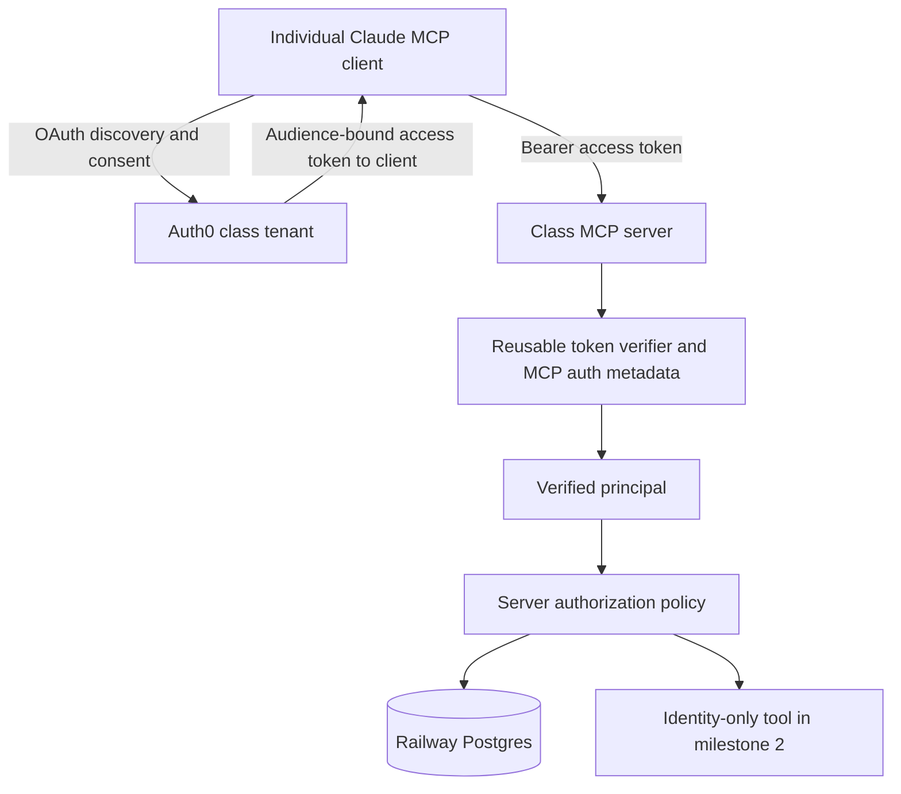

# Milestone 2: reusable class MCP identity and durable authorization

Date: October 17, 2026 (America/Chicago)
Status: design approved by the operator on October 17, 2026; storage revised to Railway Postgres at the operator's request the same day. The [implementation plan](../plans/2026-10-17-milestone-2-identity-authorization.md) is prepared for review; implementation, account provisioning and production auth verification have not started.

## 1. Intent and accepted decisions

Students use their own identities to access class MCP servers. Each server authorizes its own operations. The Blender bridge additionally requires ownership of the selected laptop, explicit local consent and a current work grant. Successful login does not authorize desktop control.

The operator approved Auth0 plus Railway Postgres and confirmed that invited, verified email is sufficient for the pilot. Northwestern NetID/enterprise SSO is not required. The design must support additional class MCP servers without copying Blender-specific policy or introducing a shared desktop bearer key.

Keep the pilot on Railway with one authorization-service instance and one private Railway Postgres instance. Only the database service has a persistent volume; the identity app has no data volume. Keep the existing public ping probe separate and harmless. The operator prefers direct commits/pushes to main and no PR requirement.

Success means real individual authentication, durable and revocable enrollment, verified separation of resources/accounts, and explicit evidence about simultaneous sessions belonging to the same student. It does not mean that an authenticated student can already operate Blender.

## 2. Scope and release boundaries

Milestone 2 delivers:

- A reusable TypeScript MCP authentication package, initially maintained in this repository.
- Auth0 configuration/runbooks for invited email-code login, MCP OAuth and per-server audiences/scopes.
- A separate authenticated HTTPS MCP entrypoint exposing only `class_identity`, plus public health/discovery metadata.
- A PostgreSQL repository for identities, course/team membership, devices, credentials, work contexts, pairings, leases, revocations and audit metadata.
- Operator enrollment/disable/revoke commands and safe startup, backup and restore procedures.
- Automated verification plus actual Auth0/Claude cloud compatibility evidence.

Production laptop enrollment, outbound WSS, connector distribution and real Blender integration remain milestones 3 and 4. Durable device/lease policy can be exercised through local test adapters in milestone 2. No production desktop tools or public agent/WSS endpoint are enabled by this milestone.

There is a partial delivery boundary: identity/persistence can ship for evaluation even if actual Claude session isolation is unproven. In that case milestone 2 is **not fully accepted** and desktop activation remains unavailable. Section 8 defines the gate and its possible blocked outcome; a mock passing is insufficient.

## 3. Architecture and reuse

Auth0 owns authorization/token endpoints, hosted login, email-code verification and refresh-token handling. Our MCP services are OAuth resource servers; they do not implement their own authorization server or proxy Auth0 tokens to laptop adapters.

### Shared package

Create `packages/auth/` with an eventual private package identity `@northwestern-mpd/mcp-auth`. Develop it as a local package; publishing a registry artifact is not required for milestone 2. Its public contracts are:

| Contract | Responsibility |
|---|---|
| `AuthConfig` | Exact issuer, trusted JWKS URI, this service's resource/audience URI, allowed client IDs, required scopes, the fixed verified-email claim contract and clock tolerance |
| `verifyAccessToken` | Verify an access token and return a normalized immutable principal; no enrollment lookup |
| `requireScopes` | Require every scope requested by the caller, with deny-by-default behavior |
| `protectedResourceMetadata` | Produce discovery metadata from trusted deployment configuration |
| `authenticationChallenge` | Produce a standards-compatible 401 challenge without leaking token contents |
| `VerifiedPrincipal` | Issuer, subject, authenticated client ID, effective scopes, issued/expiry times and verified-email evidence; optional provider claims only when validated |

The package must not import the Blender policy engine, PostgreSQL, connector code or fake adapters. Resource-specific authorization is injected by each service. Token parsing, metadata and error behavior are shared; tools, memberships, local consent and leases are not automatically granted by the package.

Keep PostgreSQL access in `packages/storage/` and bridge authorization in `packages/authorization/`. Introduce a repository interface around current policy persistence without rewriting unrelated mock behavior. Retain existing fixture entrypoints and tests as explicitly local development paths.

### Additional class servers

Use one Auth0 production tenant as the class identity authority. Register each MCP server as a distinct API/resource with its own exact audience and least-privilege scopes. A token issued for the Blender bridge must fail validation at an assignment or course-material server. Configure each server with a different resource URI even though they share issuer and signing keys. Avoid a single broad audience spanning unrelated services.

Register OAuth client applications separately from API resources: Claude is a client; our MCP service is a resource. A server can have multiple permitted clients, and a client may seek consent for different servers. A provider client ID, browser SSO session or email address is not a course/team identifier.

Reuse student identity as `(issuer, subject)`. Other servers can use their own enrollment store through the repository interface. Sharing a live class roster across separately deployed services requires an authenticated roster API in a later slice; milestone 2 does not introduce that API or promise fleet-wide immediate revocation. Other class MCP servers do not receive this service's database credentials or table privileges. If a later service needs database access, give it an isolated schema/role or a narrow authorization API under a separate design. Sharing the Auth0 tenant/package does not imply sharing all database authority.

A second server verifier, using a different audience and a minimal test authorization policy, is required as a reuse acceptance fixture. It is not another public service.

## 4. Student enrollment and email authentication

Use Auth0 hosted email one-time-code login. Disable public signups on the pilot passwordless connection and pre-provision permitted accounts. Configure a production SMTP provider before inviting students; Auth0's built-in sender is only for development. Sender domain/provider configuration is an operator prerequisite, not an assumption that we can send as Northwestern.

Operator enrollment flow:

1. Create an explicit course/team and import exact invited email addresses through an operator-only command. Normalize whitespace/domain casing without removing dots, plus tags or otherwise merging distinct addresses.
2. The provisioning command creates or deliberately selects a subject on the configured Auth0 email connection. Record its exact issuer/subject and a pending local invitation. If Auth0 succeeds and local persistence fails, retry idempotently by reconciling that exact subject; never create memberships through a token-supplied email match.
3. Disable signup on the email connection and enable it only for the approved OAuth clients. Connection-wide scope is intentional for this pilot tenant; a different class server can authorize a different subset of the tenant's users locally.
4. Send the invitation through the production email sender. An invitation identifies access that is pending; it is not a bearer credential granting MCP or desktop permissions.
5. The student follows the client's native OAuth flow and proves email control using Auth0's code. A signed custom access-token claim conveys verified-email status. An Auth0 Action copies it from Auth0's trusted user verification state, never from request parameters or editable user metadata.
6. On the first authenticated MCP call, transactionally activate the matching pending enrollment only when issuer/subject match and verified-email evidence is true. Require an unexpired invitation; pilot invitation lifetime is seven days. Uninvited, expired, revoked or disabled records remain denied even with a valid Auth0 login.

Use the literal custom claim `https://github.com/Northwestern-MPD/claims/email_verified` across the Auth0 Action and shared package. This is a claim namespace, not an endpoint to fetch. The verifier requires that exact signed claim to equal boolean `true`; export its name as a shared constant so class servers cannot drift. Do not rely on default access tokens containing email/profile fields, and do not accept an ID token as an API access token.

Subjects remain stable when display email changes. Do not link accounts or migrate enrollment automatically by email. A change of sign-in connection or provider subject requires an explicit operator reconciliation, including revocation of old credentials/grants. Course/team membership always comes from our database, never a claimed domain, Auth0 display organization or MCP argument.

Operator commands are administrative functions, not MCP tools. Provisioning uses a narrowly scoped Auth0 Management API client outside the request-serving process. Its credentials are never copied into student configs. Runtime authorization mutations execute through the gateway's administrative handler over a local Unix socket with owner-only filesystem permissions (0600), reachable by the operator through Railway's authenticated shell, so SQL changes and runtime invalidation share the same path. No public admin HTTP surface is introduced.

## 5. OAuth resource-server behavior

Add a new production entrypoint in `apps/identity/`; do not widen the loopback mock gateway. Deploy it as a separate Railway service with one replica and its own HTTPS domain, connecting to private Postgres without an app data volume. Reuse the existing Railway project. The current ping service and its STDIO/HTTP config entries remain available for comparison.

| Surface | Behavior |
|---|---|
| `GET /health` | Public liveness, no identities, tokens or configuration values |
| `GET /ready` | Ready only after configuration, schema/store validation, runtime ownership and startup revocation complete; no internal diagnostics in the public response |
| Protected-resource metadata | RFC 9728 document identifying this service and Auth0, at the standard resource-appropriate well-known path |
| `POST /mcp` | Authenticated MCP initialization, catalogue and identity invocation; enforce auth on every request |
| MCP session transport methods | Support methods required by the pinned SDK; each request is reauthenticated and checked for principal/context ownership |
| `class_identity` | No arguments; returns internal user ID, server resource ID and current authorized course/team IDs, with `desktop_access: false`; no email, tokens or raw claims |

Require `identity:read` for the first MCP tool and its catalogue. Future bridge/device scopes are registered/enabled only when their associated functionality is ready; a broad scope alone will never override local consent.

Use Auth0 Authorization Code with PKCE S256 for public MCP/native clients. Enable/test RFC 8707 resource compatibility so tokens have our exact audience. Prefer operator-approved CIMD/static client registration; do not expose an unrestricted registration proxy. If the actual Claude cloud path requires DCR or preconfigured client credentials, verify the provider-supported configuration against that client and record it before admitting the integration. Do not fabricate a client secret or downgrade to a shared course key to bypass an incompatibility.

Token policy:

- Use a maintained JOSE verifier with explicitly permitted asymmetric signing algorithm RS256. Resolve keys only from the configured Auth0 JWKS endpoint; never fetch token-provided issuer, `jku` or `x5u` URLs.
- Validate signature, exact issuer including its canonical trailing-slash form, audience membership, nonempty subject, required scope set, `exp`, and `nbf` when present. Require `iat` for the pilot and reject future issuance beyond a 60-second clock tolerance. Set the API access-token lifetime to 600 seconds and verify actual issued lifetimes during integration.
- Configure the API to use Auth0's default access-token profile for this pilot; switching to a different token profile requires a reviewed verifier-contract change. Require Auth0's signed `azp` claim as the authenticated client ID and check the explicit allowlist. If a `client_id` claim is also present, require it to agree. Missing, non-string or contradictory client identity is denied; do not silently choose another field. Verify this contract against real issued tokens before integration is accepted. These IDs identify clients, not individual cloud chats. Parse effective scopes from the signed OAuth `scope` string, without unioning user metadata or requested tool arguments into it.
- Reject wrong-server tokens, ID tokens, unsupported algorithms, malformed claims, duplicate/oversized bearer headers, expired tokens, absent scopes and fixture credentials. The existing mock bearer parser cannot parse JWTs and must not be reused as the production verifier.
- Cache trusted JWKS for at most one hour, refresh after ten minutes and rate-limit unknown-key refresh attempts. An unknown key or unavailable first fetch fails closed; an already cached trusted key can validate tokens within the configured cache lifetime. Do not make Auth0 Management API calls on every request.
- Missing/invalid token returns 401 with `WWW-Authenticate` discovery metadata. Missing scope returns a standards-compatible insufficient-scope response. A verified principal denied by current enrollment/ownership receives 403. Store/migration failure returns 503, never a fallback to fixture or in-memory authority.

Exact deployment resource URI, issuer and client registrations are operator configuration inputs; the signed verification-claim name is fixed above. Examples in docs must be labeled examples, not working resources. `class-identity` is the proposed MCP config name; add its actual URL only after the new service exists. A native unauthenticated ping does not prove OAuth UI support, refresh or credential delivery in Claude cloud; test each through the selected client path.

## 6. PostgreSQL data model and authorization transactions

Use the pure JavaScript `pg` driver with parameterized SQL and versioned migrations, pinned after checking Node 22 compatibility. Do not add `pg-native` or an ORM. Deploy one Railway Postgres service in the same project/environment as the identity service. Record its supported major version before provisioning; local/CI databases must match it. The application's storage is a dedicated database/schema, never a local file.

Use private Railway networking with no public TCP proxy. For the pilot, explicit `railway-private` transport mode permits a non-TLS pg connection only to the configured `.railway.internal` host inside Railway's encrypted private network. External/admin connections require certificate-verified TLS with a trusted CA; never use rejectUnauthorized=false. Local disposable tests may use plaintext loopback/CI-service networking under an explicit test mode. Connection URLs and passwords are secrets and are never logged.

Separate database authority: a NOLOGIN schema owner; a migration login allowed to act as that owner for DDL; an application login limited to CONNECT/USAGE and the required DML/sequences in `mpd_identity`; and a backup login with read-only access to that schema. Revoke unnecessary PUBLIC database/schema privileges. The app has no superuser, CREATEDB, CREATEROLE, schema-creation or migration rights. Migration/admin/backup secrets are supplied only to operator jobs; the normal serving process receives only its application DATABASE_URL. Other MCP servers never reuse that login.

| Record | Required information and constraints |
|---|---|
| `users` | Internal random UUID, active/pending/disabled state, authorization version, timestamps |
| `identities` | Unique `(issuer, subject)`, user FK, connection/provider provenance; no automatic linking |
| `invitations` | Exact roster email, intended issuer/subject, course/team target, pending/accepted/revoked state, expiry; roster emails excluded from routine logs |
| `courses`, `teams`, `memberships` | Explicit user assignment, status/role and membership version; uniqueness/FKs prevent duplicate active memberships |
| `devices` | Random ID, owner FK, display name, disabled state, monotonically increasing connection epoch; a display name never routes traffic |
| `device_credentials` | Random credential ID, SHA-256 fingerprint of a high-entropy secret, device FK, generation, deployment authorization epoch, expiry, revocation and last-use metadata |
| `work_contexts` | User, resource/audience, client ID, verified binding provenance when available, boot ID, deployment authorization epoch, state, expiry; no claimed Claude chat ID |
| `pairings` | Context/owner/team, fingerprint of a request code with at least 128 bits of randomness, bounded requested capabilities, expiry, consumed/revoked state |
| `leases` | Context/device/team FKs, granted capabilities, epoch, expiry/idle deadlines, terminal state/reason; active ownership enforced transactionally |
| `operation_attempts` | Request/correlation ID, lease/device/epoch, read/write classification, admitted/dispatched/completed/uncertain state and timestamps; no tool arguments or replay payload |
| `token_denials`, `user_resource_blocks` | Token fingerprints, local subject/resource blocks, validity deadlines and administrative reason codes |
| `audit_events` | Timestamp, internal actor/resource/device/grant IDs as applicable, action, outcome/reason, correlation ID; no request bodies |
| `schema_migrations`, `service_state` | Migration version/checksum, expected store UUID, deployment authorization epoch, monotonic token issuance cutoff, stored maintenance state and startup boot ID |

Use a bounded pg pool: maximum five request connections, 5-second connection timeout, 30-second idle timeout, 5-second statement timeout, 2-second lock timeout and 10-second idle-in-transaction timeout. A separate dedicated connection holds the single-owner runtime advisory lock; it is not a pool checkout retained indefinitely. Handle pool/client errors, always release checked-out clients and close both pool and owner connection on shutdown. Loss of database connectivity or ownership disables admission/dispatch; readiness becomes unavailable. Never fall back to in-memory authority or replay a mutation after reconnection.

Migrations run as an explicit operator job under the migration role before app admission, serialized by a schema-migration advisory lock. Use transactional versioned migrations with checksums; refuse an unsupported newer schema or a failed/partial migration. Initialization writes an explicit store UUID marker under maintenance. Startup checks the schema version and configured expected store ID; it never creates a missing database/schema or runs DDL as the application role. A second app instance unable to acquire the runtime-owner advisory lock refuses readiness rather than invalidating the first instance's grants. Configured replica count remains one.

Every transaction uses one checked-out PoolClient from BEGIN through COMMIT/ROLLBACK; never combine pool.query calls across a transaction. Under READ COMMITTED, lock the affected user/membership/device/context/pairing/lease rows in a consistent documented order with SELECT FOR UPDATE. Partial unique indexes additionally enforce one active lease per user and device. Approval/consumption, lease creation, revocation and their audit events commit atomically. Expired leases are transitioned before new approval, and deadlines are checked using a fresh clock after lock waits. Map unique conflicts, lock timeouts, serialization failures and deadlocks to controlled denial/conflict responses; do not retry a mutation automatically.

Create immutable server-only per-request authentication evidence after verification: the VerifiedPrincipal (including issuedAt/expiresAt), exact configured resource and SHA-256 token fingerprint. Never construct it from tool arguments or infer it from a retained MCP context; refresh/continued requests receive fresh evidence. Every protected identity request and operation checks the current issuance cutoff, token expiry/denial, principal/client/resource binding and local permissions. No bearer token or full claim bag is retained.

Because pg operations await network I/O, a single-process dispatch coordinator serializes operation admission and administrative revocation. It holds an authority fence while rechecking that request evidence against current token denials, expiry, issuance cutoff, context and permissions in a transaction, committing a metadata-only operation intent, rechecking readiness, token expiry and deadlines immediately before synchronously enqueueing a frame to the local test transport. The private admin handler is wired to the identical coordinator instance; its revocation path uses the same fence exactly once (without nested acquisition), commits denial, invalidates runtime authority and only then acknowledges success. Do not hold database transactions or the coordinator while awaiting a remote execution result. Another writer can never bypass the coordinator through a public admin endpoint or direct shared database credentials.

An intent without a confirmed terminal result is execution-uncertain after interruption, including a connection loss during COMMIT. A reconnect or ambiguous commit must never cause a resend. Persist policy/operation metadata, not sockets, timers, tool arguments, scene data, Python or screenshots. In-flight operations cannot be rolled back by revocation; preserve uncertain-outcome reporting.

## 7. Revocation, refresh and credentials

JWT signature validity does not establish current permission. Every protected request consults the current local user/resource block, membership and applicable credential/grant state. Avoid positive authorization caches in the single-instance pilot.

Local disable/revoke commands take effect before the next dispatch: commit state, invalidate matching runtime contexts/leases, notify a connected local test adapter and reject waiting operations as appropriate. Already dispatched mutations may be uncertain; do not claim rollback. Team removal revokes affected leases even when an Auth0 token is still valid.

Auth0 refresh-token revocation/logout does not revoke an already issued JWT at our gateway. For immediate local denial, block the subject/resource or explicitly deny the presented token fingerprint. A single fingerprint denial does not revoke a whole refresh-token family; use a subject/resource block when no reliable grant-family identity exists. Token-denial rows expire only after their token expiry plus clock tolerance.

Auth0 manages client refresh tokens. Native MCP clients store their own tokens; our gateway does not receive, log or store those refresh tokens. Request offline access only when the client needs it, enable supported refresh rotation/reuse detection and bounded expiry, and verify the real client's behavior. A refreshed valid token retains identity but does not automatically recover an old desktop lease or establish a new work-session binding.

Provider-side disable/revoke is a second control, not an instantaneous local synchronization mechanism. The pilot runbook disables locally first and then blocks/revokes at Auth0. An Auth0-only account block may leave previously issued API tokens usable until expiry unless local denial is also applied. This limitation must be tested and documented; no webhook synchronization or fleet-wide revocation guarantee is implied.

Device credentials are a separate purpose-bound credential type, never accepted as MCP user tokens. Generate at least 256 bits of randomness, return a new secret only once over an approved enrollment channel, store only its fingerprint server-side, and rotate generations atomically. Lost-device revocation invalidates credentials and leases. Laptop storage must use macOS Keychain or Windows Credential Manager; absence/failure must not silently write a plaintext file. Milestone 2 defines and tests this storage interface with test implementations; real OS enrollment/storage evidence is required during milestone 3. No student credentials belong in `.mcp.json`, environment labels, git, stdout or audit payloads.

## 8. Same-user cloud session isolation: mandatory evidence gate

A verified Auth0 subject proves the user. `client_id`/`azp` proves an OAuth client. A provider `sid` can represent a browser/provider session. None is assumed to uniquely identify a Claude cloud chat. An MCP session ID is a routing handle, not an authenticated independent identity.

Milestone 2 must measure the actual native cloud behavior before declaring the desktop grant model viable:

1. Use two simultaneous cloud sessions for the same enrolled student, plus a different student's session. Exercise project MCP and/or the selected connector delivery path explicitly; record which path is tested.
2. Record only sanitized issuer/subject/client/audience facts, whether token/grant fingerprints match, and whether independent MCP transports exist. Never expose full claims or credentials to the model or evidence file.
3. Exercise new initialization, a copied token, a copied MCP session handle, refresh, reconnect and logout. A new unrelated context must not inherit a previously approved test lease; a transport handle alone must never authorize it.
4. Require a demonstrable, integrity-protected work-context credential or separately scoped OAuth grant that the native client actually keeps distinct. Bind local approval to that context, resource, owner, device and epoch. Do not manufacture this distinction from an argument, a random tool-returned string or an unverified provider claim.
5. If the native host shares the same credentials/transport across chats and offers no verifiable distinction, the gateway cannot distinguish those requests. Record `SESSION_ISOLATION_UNPROVEN`, keep every public desktop capability disabled, and do not mark milestone 2 fully accepted. Changing this product requirement or adopting a supported per-work-session credential/client configuration requires an explicit follow-up design based on observed client capabilities.

The durable model supports a verified context binding but does not assert that Auth0 alone supplies one. Passing the existing mock conflict test is only local policy evidence. Identity-only class tools may be evaluated while this gate is unresolved; no desktop rollout follows automatically.

## 9. Restart, backup and restore

Before readiness, acquire the dedicated runtime-owner advisory lock, verify schema/store ID/maintenance state and generate a new boot ID. In one transaction invalidate prior contexts, pending pairings and active leases, mark devices offline, advance epochs and mark unfinished mutation intents uncertain. Preserve enrollment, credentials and revocation history. A database restart or lost ownership ends the current serving lifetime: close admission/transports, reject pending work and exit; a new process must complete recovery before admission. No automatic mutating retry or silent continuation using cached grants.

Initial provisioning creates the Postgres database, roles and schema through explicit privileged operator commands. Apply migrations and write the store marker while maintenance is enabled, then deploy the app with its limited role and expected store ID. Missing DB/schema, wrong store ID, privilege failure or unsupported schema fails closed. There is no app-file initialization flag, volume ownership repair or root startup helper.

Enable daily Railway backups on the database service and record availability, retention and cost from the actual account. Add a portable schema-scoped logical backup using pg_dump custom format, without embedded ownership/ACL restoration; take it with the dedicated backup role and protect/encrypt the artifact. Use matching-version pg_dump/pg_restore tools in the operator environment, with credentials in protected configuration rather than command-line URLs or logs. Restore with pg_restore --exit-on-error --no-owner --no-privileges under the target migration/owner role, then explicitly regrant limited target roles. Use an isolated target and validate schema versions/checksums, expected tables/constraints, role permissions and representative authorization invariants. Never validate a restore by replaying a mutation. PITR is optional only after its account support/cost and a restore drill are checked.

For production recovery: set maintenance outside the database, stop/drain the identity app, restore into a separate target, validate it, provision target roles/grants, rotate database credentials, advance AUTHZ_DEPLOY_EPOCH in Railway config, then switch the app's private DATABASE_URL. The restored store marker must match AUTHZ_STORE_ID. Epoch mismatch suspends restored users/memberships and invalidates all old contexts/device credentials before admission; reconcile against the current roster/revocation evidence using the RecoveryManifest below and deliberately reissue device credentials. Reopen only after an operator denial/revocation check. Keep the original database isolated for rollback until explicitly retired; restoring does not authorize deleting it.

Recovery must also invalidate Auth0 access tokens whose local denials may be absent from the backup. Before restoring, record AUTHZ_TOKEN_IAT_AFTER outside Postgres as a Unix-seconds cutoff at least 60 seconds after the operator's trusted current UTC time following stop/drain. Persist the maximum of the configured and stored cutoff before readiness; reject ordinary configuration decreases. On every protected request and inside dispatch admission require signed iat strictly greater than the cutoff, with no clock-tolerance subtraction; token expiry is still checked independently. The cutoff remains across restarts, releases and rollbacks and advances for every restore. Tokens issued while waiting for the future cutoff may be denied; obtain a fresh token after it. Changing only AUTHZ_DEPLOY_EPOCH cannot invalidate an Auth0 JWT.

Before reactivation, the operator supplies a RecoveryManifest from current trusted roster and revocation evidence kept outside the restored database (for example protected operator records/current authoritative decisions). It binds the store ID, new deployment epoch and cutoff, lists explicitly approved existing memberships, disabled users, removed memberships and subject/resource blocks, and records reviewed source references. A manifest cannot claim that the restored database proves current permissions. Apply denials before any activation in one transaction; a denial wins over an approval. If current revocation completeness cannot be verified, keep the affected users/memberships suspended and admissions closed for them. The cutoff permanently rejects old JWTs; current subject/resource blocks must also deny fresh tokens and are not cleared by roster reconciliation. Pending invitations from the backup are revoked on recovery and must be deliberately reprovisioned. Test a token denied after the snapshot through restore, reconciliation and resumed admissions while that token is still unexpired, plus a fresh token for a still-blocked subject/resource.

Retain audit metadata for 30 days, token denials through token expiry plus clock tolerance and roster PII through course close plus 30 days, unless an approved requirement supersedes those defaults. Keep necessary enforcement/FK records. Protect backup access and document platform backup retention separately; application deletion does not erase historical backups immediately.

## 10. Deployment, configuration and costs

Add an identity-only Node service and one private Railway Postgres service to the existing project/environment. The database owns its persistent volume; the Node image runs as the Node user and has no data volume or native database dependency. Keep the existing public ping service unchanged during verification. Set one identity replica; database sharing alone does not implement WSS multi-instance routing or independent cloud work contexts.

Every identity deployment and rollback uses an explicit operator-controlled stop/start procedure, accepting brief pilot downtime. Disable GitHub autodeploys and image auto-updates for this identity service; changes to variables/build settings must be staged without automatically starting a replacement. Before applying/releasing them, set maintenance on the incumbent through the private admin handler, reject new work, drain for at most the 30-second RPC deadline, mark unfinished mutations uncertain, close transports and stop that deployment. Confirm it is stopped and its dedicated owner connection/lock is released before starting the replacement. Force-stop an unresponsive incumbent and verify lock release rather than allowing concurrent owners. A replacement started too early must fail closed without disturbing the incumbent. Preserve recovery cutoff/epoch settings on rollback, and run only a schema-compatible release. Verify health=200, ready=503 and denied admission while maintenance is active; then clear stored maintenance through the private socket with AUTHZ_MAINTENANCE=false and require ready=200 plus an unauthorized-account denial check. The external maintenance flag is a hard-deny override; socket commands cannot clear it. Do not rely on one replica, a changed health endpoint or an automatic rolling handoff to transfer ownership; Railway normally holds the incumbent until its replacement passes healthcheck. Task 7 tests the overlapping-start refusal and explicit handoff; Task 8 records the actual hosted procedure.

Required configuration is validated before admission:

| Setting | Purpose |
|---|---|
| AUTH0_ISSUER, AUTH0_JWKS_URI | Trusted canonical issuer/key source |
| MCP_RESOURCE_URI, AUTH0_ALLOWED_CLIENT_IDS | Exact resource audience and approved clients |
| DATABASE_URL | Secret private connection using the limited application role, with explicit database name |
| DB_TRANSPORT_MODE, DB_CA_CERT | Explicit railway-private, verify-full or local-test policy; trusted CA required for external TLS |
| AUTHZ_STORE_ID | Expected UUID marker of this logical authority store; detects wrong/empty databases |
| AUTHZ_DEPLOY_EPOCH | External credential invalidation epoch, advanced after restore/security reset |
| AUTHZ_TOKEN_IAT_AFTER | Nonnegative Unix-seconds cutoff; 0 for initial provisioning, monotonically advanced outside the restored DB on recovery; require iat strictly greater |
| AUTHZ_MAINTENANCE | Deny admission during initialization, migration or reconciliation |
| PORT, deployment origin | Railway port and explicit origin/Host policy |

MIGRATION_DATABASE_URL and BACKUP_DATABASE_URL are separate operator-job secrets, never supplied to the normal app process. Test database credentials are disposable and never point at the hosted authority store. Auth0 Management and SMTP credentials remain outside the normal request-serving process. Native client secrets, if required by the verified registration, belong only in supported client secret storage and are never committed.

Retain 64 KiB body bounds, session/user/IP limits, finite timeouts and rejection of unapproved browser Origins. Health is public liveness; readiness also checks database connectivity, expected schema/store, runtime ownership and maintenance. The native MCP bearer endpoint must not gain cookie-based authority. Public health/readiness responses contain no sensitive details. When Postgres becomes unavailable after startup, protected requests return a bounded 503, never cached permission success.

Add Dockerfile.identity.dockerignore beside Dockerfile.identity; the existing root .dockerignore only allows probe build artifacts. The identity-specific allowlist includes package.json, package-lock.json, tsconfig.json, Dockerfile.identity and the required apps/packages/scripts TypeScript inputs, with parent directories traversable. Exclude .git, node_modules, work/operator records, dumps, .env files and credentials, including any nested private artifacts within otherwise allowed directories. Test sentinel-secret exclusion from the build context and image; leave the root probe allowlist intact. Build from the repository root using docker build -f Dockerfile.identity .

Use a multi-stage Node image with npm ci --ignore-scripts, TypeScript compilation and production-only dependencies. The app uses pg without a native rebuild and starts directly as the Node user; SessionStart does not start a database. Run real Postgres integration tests in disposable databases matching the selected Railway major; separate those from dependency-free probe/unit tests. Existing npm test and bundled probe discovery must not require a database or Docker. CI explicitly runs the database suite against its Postgres service; Docker image checks remain a separate command.

Review Auth0 entitlements, SMTP delivery, Railway usage alerts and hard-limit impact before invitations/deployment. Postgres adds database RAM/CPU, volume and backup usage; do not quote an unmeasured flat database price or claim current account limits are configured. No Redis, HA database cluster, PgBouncer service, SSO purchase or custom-domain purchase is part of this pilot.

## 11. Acceptance matrix and evidence

| Area | Required result |
|---|---|
| Token verification | Valid access token accepted; wrong issuer/audience/key/algorithm, ID token, expired/future/invalid claims and fixture bearer denied |
| Client/scopes | Unknown client and missing required scopes denied; valid client/scopes never bypass local enrollment |
| Invitations | Invited verified subject activates once; unverified, uninvited, expired, disabled, reused invite and email-only spoof denied |
| Stable identity | Email/display-name changes do not change ownership; different issuer/subject cannot inherit enrollment |
| Reuse | Second server fixture uses the same package; each rejects the other's audience and enforces its own scopes/policy |
| Real native OAuth | Actual Claude cloud login, tool discovery and `class_identity` identify the enrolled account with no shell/SDK substitute |
| Two real accounts | Separate students get separate identities/rosters; same-team membership grants no other student's device access in local policy tests |
| Same user, two sessions | Section 8's real-client experiment establishes independent approved contexts, or records an explicit blocked result and keeps desktop disabled |
| Refresh/logout | Real-client refresh behavior observed; expired/revoked refresh fails as configured; local denial rejects still-valid access tokens |
| Disable/removal | Local disable, membership removal, token/resource block and device revoke deny the next authorized dispatch and terminate affected grants; a token denied between HTTP verification and fenced admission sends no frame, and token expiry during a lock wait also denies |
| Concurrency | Independent Postgres clients cannot create multiple active leases, reuse pairings or overlap writes; lock timeout/deadlock/ambiguous commit and dispatch-vs-revoke tests fail closed without replay |
| Deployment handoff | Overlapping replacement fails closed without invalidating the incumbent; explicit drain/stop/lock-release/start succeeds for deploy and rollback with autodeploys disabled |
| Restart | Enrollment/revocation survives; contexts/leases/pairings die, epochs advance, devices offline; no mutation replay |
| Storage failure | Missing database/schema, incorrect store marker, pool exhaustion, network/owner-connection loss, failed migration and wrong role privileges fail closed; no in-memory fallback |
| Backup restore | Isolated pg_restore/constraint/role checks pass; maintenance, new epoch, monotonic issuance cutoff and current revocation manifest prevent authority resurrection after reconciliation/reopened admission; unknown revocation state stays denied |
| Secrets/logs | Captured responses/logs/audit contain no bearer, refresh/device secret, OTP, raw token claims, code, screenshot or scene payload |
| Existing behavior | Current mock policy tests and dependency-free ping probe remain valid; generated artifacts drift only when their sources change |

Start implementation with meaningful failing tests for the selected slice. Run existing tests, typecheck and build as appropriate to the changed components; verify probe regeneration drift when probe dependencies/sources change. Version exact new dependencies before installation and commit lockfile changes. A documentation review does not require rerunning application tests.

Keep automated/local evidence, direct hosted HTTP evidence and operator-reported native cloud evidence separate. Record selected branch/commit, client/version when exposed, resource URI, tested OAuth path, sanitized results and restart outcome. Provider documentation or a demo SDK client is not proof of native Claude compatibility.

Milestone 2 is accepted only when the required identity, durability, revocation and real-client outcomes pass, including section 8. A useful authenticated identity-only release is explicitly partial if that gate remains blocked. Device/Blender production acceptance still belongs to later milestones.

## 12. Operator inputs and next artifact

Before live integration, obtain the Auth0 tenant/environment, approved native client registrations, production SMTP sender/provider, two test student emails, explicit course/team roster and private Postgres database/role/backup configuration. Record actual nonsecret issuer/resource/client configuration; keep secrets in their designated stores. Provisioning is not performed as part of writing this spec.

Review this document before producing the implementation plan. The plan should split delivery into testable slices: reusable verification/metadata, Postgres/enrollment/revocation, Auth0 plus native identity compatibility, same-user context evidence, and restart/restore acceptance. These are design boundaries, not an approval to implement or expose desktop tools.

## References checked October 17, 2026

Provider capabilities below inform the integration; concrete tenant/client behavior remains subject to the acceptance tests.

- [Auth0 Auth for MCP general availability](https://auth0.com/blog/auth0-auth-for-mcp-servers-generally-available/): managed MCP OAuth and client/resource support.
- [Auth0 MCP audience configuration](https://support.auth0.com/center/s/article/mcp-audience-error-with-auth0): resource compatibility configuration.
- [Auth0 email OTP](https://developer.auth0.com/resources/labs/authentication/passwordless-with-email): hosted email-code flow and production sender configuration.
- [Auth0 passwordless signup restrictions](https://support.auth0.com/center/s/article/How-to-restrict-email-domains-from-registering-to-the-Passwordless-email-connection): disabling open registration.
- [Auth0 access-token logout limitation](https://support.auth0.com/center/s/article/Invalidate-the-API-token-after-user-logout): already-issued access tokens require explicit resource-server controls for earlier denial.
- [Auth0 refresh-token issuing-client restriction](https://support.auth0.com/center/s/article/A-Refresh-Token-Must-Be-Revoked-by-Its-Issuing-Client): client-specific token revocation behavior.
- [Auth0 pricing](https://auth0.com/pricing): account allowances must be checked before provisioning.
- [Railway Postgres](https://docs.railway.com/databases/postgresql), [private networking](https://docs.railway.com/networking/private-networking) and [Postgres backup/restore](https://docs.railway.com/guides/postgres-backups-restores): private database deployment, encrypted inter-service transport and restore options.
- [node-postgres transactions](https://node-postgres.com/features/transactions), [pooling](https://node-postgres.com/features/pooling) and [TLS](https://node-postgres.com/features/ssl): per-client transaction boundaries and connection handling.
- [Postgres row/advisory locks](https://www.postgresql.org/docs/17/explicit-locking.html): concurrency and ownership guards.
- [Railway healthchecks](https://docs.railway.com/deployments/healthchecks): replacement startup and incumbent deployment lifecycle.
- [Docker build context](https://docs.docker.com/build/concepts/context/): Dockerfile-specific ignore-file precedence.
- [Railway pricing](https://docs.railway.com/pricing) and [cost controls](https://docs.railway.com/pricing/cost-control): budget planning and account-level limits.
- [MCP authorization specification](https://modelcontextprotocol.io/specification/latest/basic/authorization): discovery, audience validation and OAuth responsibilities; match implementation to the pinned SDK/client capabilities.
