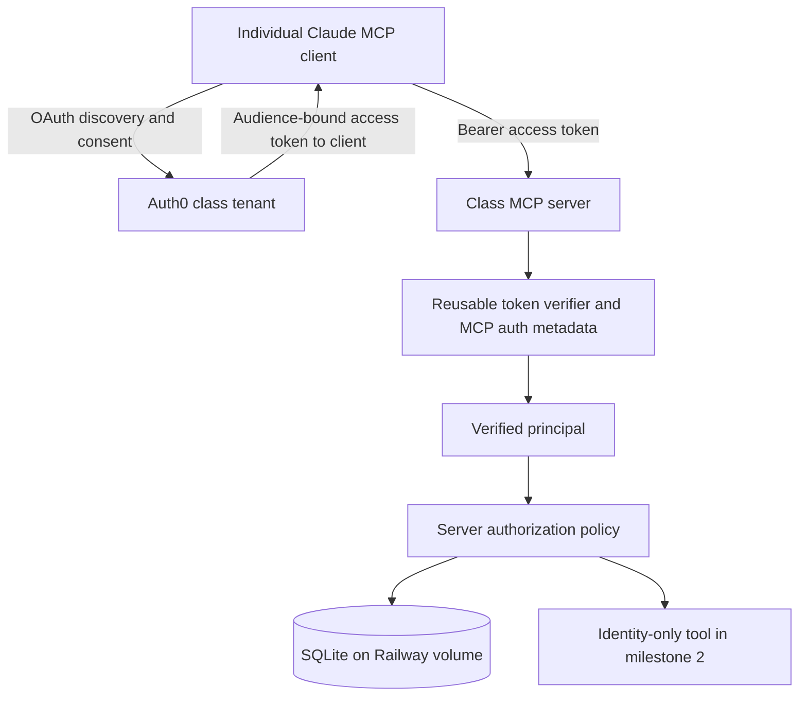

# Milestone 2: reusable class MCP identity and durable authorization

Date: October 17, 2026 (America/Chicago)
Status: design approved by the operator on October 17, 2026. The [implementation plan](../plans/2026-10-17-milestone-2-identity-authorization.md) is prepared for review; implementation, account provisioning and production auth verification have not started.

## 1. Intent and accepted decisions

Students use their own identities to access class MCP servers. Each server authorizes its own operations. The Blender bridge additionally requires ownership of the selected laptop, explicit local consent and a current work grant. Successful login does not authorize desktop control.

The operator approved Auth0 plus SQLite and confirmed that invited, verified email is sufficient for the pilot. Northwestern NetID/enterprise SSO is not required. The design must support additional class MCP servers without copying Blender-specific policy or introducing a shared desktop bearer key.

Keep the pilot on Railway with one authorization-service instance and a persistent volume. Keep the existing public ping probe separate and harmless. The operator prefers direct commits/pushes to main and no PR requirement.

Success means real individual authentication, durable and revocable enrollment, verified separation of resources/accounts, and explicit evidence about simultaneous sessions belonging to the same student. It does not mean that an authenticated student can already operate Blender.

## 2. Scope and release boundaries

Milestone 2 delivers:

- A reusable TypeScript MCP authentication package, initially maintained in this repository.
- Auth0 configuration/runbooks for invited email-code login, MCP OAuth and per-server audiences/scopes.
- A separate authenticated HTTPS MCP entrypoint exposing only `class_identity`, plus public health/discovery metadata.
- A SQLite repository for identities, course/team membership, devices, credentials, work contexts, pairings, leases, revocations and audit metadata.
- Operator enrollment/disable/revoke commands and safe startup, backup and restore procedures.
- Automated verification plus actual Auth0/Claude cloud compatibility evidence.

Production laptop enrollment, outbound WSS, connector distribution and real Blender integration remain milestones 3 and 4. Durable device/lease policy can be exercised through local test adapters in milestone 2. No production desktop tools or public agent/WSS endpoint are enabled by this milestone.

There is a partial delivery boundary: identity/persistence can ship for evaluation even if actual Claude session isolation is unproven. In that case milestone 2 is **not fully accepted** and desktop activation remains unavailable. Section 8 defines the gate and its possible blocked outcome; a mock passing is insufficient.

## 3. Architecture and reuse

Auth0 owns authorization/token endpoints, hosted login, email-code verification and refresh-token handling. Our MCP services are OAuth resource servers; they do not implement their own authorization server or proxy Auth0 tokens to laptop adapters.

### Shared package

Create `packages/auth/` with an eventual private package identity `@northwestern-mpd/mcp-auth`. Develop it as a local package; publishing a registry artifact is not required for milestone 2. Its public contracts are:

| Contract | Responsibility |
|---|---|
| `AuthConfig` | Exact issuer, trusted JWKS URI, this service's resource/audience URI, allowed client IDs, required scopes, the fixed verified-email claim contract and clock tolerance |
| `verifyAccessToken` | Verify an access token and return a normalized immutable principal; no enrollment lookup |
| `requireScopes` | Require every scope requested by the caller, with deny-by-default behavior |
| `protectedResourceMetadata` | Produce discovery metadata from trusted deployment configuration |
| `authenticationChallenge` | Produce a standards-compatible 401 challenge without leaking token contents |
| `VerifiedPrincipal` | Issuer, subject, authenticated client ID, effective scopes, issued/expiry times and verified-email evidence; optional provider claims only when validated |

The package must not import the Blender policy engine, SQLite, connector code or fake adapters. Resource-specific authorization is injected by each service. Token parsing, metadata and error behavior are shared; tools, memberships, local consent and leases are not automatically granted by the package.

Keep SQLite access in `packages/storage/` and bridge authorization in `packages/authorization/`. Introduce a repository interface around current policy persistence without rewriting unrelated mock behavior. Retain existing fixture entrypoints and tests as explicitly local development paths.

### Additional class servers

Use one Auth0 production tenant as the class identity authority. Register each MCP server as a distinct API/resource with its own exact audience and least-privilege scopes. A token issued for the Blender bridge must fail validation at an assignment or course-material server. Configure each server with a different resource URI even though they share issuer and signing keys. Avoid a single broad audience spanning unrelated services.

Register OAuth client applications separately from API resources: Claude is a client; our MCP service is a resource. A server can have multiple permitted clients, and a client may seek consent for different servers. A provider client ID, browser SSO session or email address is not a course/team identifier.

Reuse student identity as `(issuer, subject)`. Other servers can use their own enrollment store through the repository interface. Sharing a live class roster across separately deployed services requires an authenticated roster API in a later slice; milestone 2 does not introduce that API or promise fleet-wide immediate revocation. Never mount/copy this live SQLite database across independent services as an integration mechanism. Sharing login/package code works without sharing database files.

A second server verifier, using a different audience and a minimal test authorization policy, is required as a reuse acceptance fixture. It is not another public service.

## 4. Student enrollment and email authentication

Use Auth0 hosted email one-time-code login. Disable public signups on the pilot passwordless connection and pre-provision permitted accounts. Configure a production SMTP provider before inviting students; Auth0's built-in sender is only for development. Sender domain/provider configuration is an operator prerequisite, not an assumption that we can send as Northwestern.

Operator enrollment flow:

1. Create an explicit course/team and import exact invited email addresses through an operator-only command. Normalize whitespace/domain casing without removing dots, plus tags or otherwise merging distinct addresses.
2. The provisioning command creates or deliberately selects a subject on the configured Auth0 email connection. Record its exact issuer/subject and a pending local invitation. If Auth0 succeeds and local persistence fails, retry idempotently by reconciling that exact subject; never create memberships through a token-supplied email match.
3. Disable signup on the email connection and enable it only for the approved OAuth clients. Connection-wide scope is intentional for this pilot tenant; a different class server can authorize a different subset of the tenant's users locally.
4. Send the invitation through the production email sender. An invitation identifies access that is pending; it is not a bearer credential granting MCP or desktop permissions.
5. The student follows the client's native OAuth flow and proves email control using Auth0's code. A signed custom access-token claim conveys verified-email status. An Auth0 Action copies it from Auth0's trusted user verification state, never from request parameters or editable user metadata.
6. On the first authenticated MCP call, atomically activate the matching pending enrollment only when issuer/subject match and verified-email evidence is true. Require an unexpired invitation; pilot invitation lifetime is seven days. Uninvited, expired, revoked or disabled records remain denied even with a valid Auth0 login.

Use the literal custom claim `https://github.com/Northwestern-MPD/claims/email_verified` across the Auth0 Action and shared package. This is a claim namespace, not an endpoint to fetch. The verifier requires that exact signed claim to equal boolean `true`; export its name as a shared constant so class servers cannot drift. Do not rely on default access tokens containing email/profile fields, and do not accept an ID token as an API access token.

Subjects remain stable when display email changes. Do not link accounts or migrate enrollment automatically by email. A change of sign-in connection or provider subject requires an explicit operator reconciliation, including revocation of old credentials/grants. Course/team membership always comes from our database, never a claimed domain, Auth0 display organization or MCP argument.

Operator commands are administrative functions, not MCP tools. Provisioning uses a narrowly scoped Auth0 Management API client outside the request-serving process. Its credentials are never copied into student configs. Runtime authorization mutations execute through the gateway's administrative handler over a local Unix socket with owner-only filesystem permissions (0600), reachable by the operator through Railway's authenticated shell, so SQL changes and runtime invalidation share the same path. No public admin HTTP surface is introduced.

## 5. OAuth resource-server behavior

Add a new production entrypoint in `apps/identity/`; do not widen the loopback mock gateway. Deploy it as a separate Railway service with one replica and its own HTTPS domain/volume. Reuse the existing Railway project. The current ping service and its STDIO/HTTP config entries remain available for comparison.

| Surface | Behavior |
|---|---|
| `GET /health` | Public liveness, no identities, tokens or configuration values |
| `GET /ready` | Ready only after configuration, SQLite migrations and startup revocation complete; no internal diagnostics in the public response |
| Protected-resource metadata | RFC 9728 document identifying this service and Auth0, at the standard resource-appropriate well-known path |
| `POST /mcp` | Authenticated MCP initialization, catalogue and identity invocation; enforce auth on every request |
| MCP session transport methods | Support methods required by the pinned SDK; each request is reauthenticated and checked for principal/context ownership |
| `class_identity` | No arguments; returns internal user ID, server resource ID and current authorized course/team IDs, with `desktop_access: false`; no email, tokens or raw claims |

Require `identity:read` for the first MCP tool and its catalogue. Future bridge/device scopes are registered/enabled only when their associated functionality is ready; a broad scope alone will never override local consent.

Use Auth0 Authorization Code with PKCE S256 for public MCP/native clients. Enable/test RFC 8707 resource compatibility so tokens have our exact audience. Prefer operator-approved CIMD/static client registration; do not expose an unrestricted registration proxy. If the actual Claude cloud path requires DCR or preconfigured client credentials, verify the provider-supported configuration against that client and record it before admitting the integration. Do not fabricate a client secret or downgrade to a shared course key to bypass an incompatibility.

Token policy:

- Use a maintained JOSE verifier with explicitly permitted asymmetric signing algorithm RS256. Resolve keys only from the configured Auth0 JWKS endpoint; never fetch token-provided issuer, `jku` or `x5u` URLs.
- Validate signature, exact issuer including its canonical trailing-slash form, audience membership, nonempty subject, required scope set, `exp`, and `nbf` when present. Require `iat` for the pilot and reject future issuance beyond a 60-second clock tolerance. Set the API access-token lifetime to 600 seconds and verify actual issued lifetimes during integration.
- Configure the API to use Auth0's default access-token profile for this pilot; switching to a different token profile requires a reviewed verifier-contract change. Require Auth0's signed `azp` claim as the authenticated client ID and check the explicit allowlist. If a `client_id` claim is also present, require it to agree. Missing, non-string or contradictory client identity is denied; do not silently choose another field. Verify this contract against real issued tokens before integration is accepted. These IDs identify clients, not individual cloud chats. Parse effective scopes from the signed OAuth `scope` string, without unioning user metadata or requested tool arguments into it.
- Reject wrong-server tokens, ID tokens, unsupported algorithms, malformed claims, duplicate/oversized bearer headers, expired tokens, absent scopes and fixture credentials. The existing mock bearer parser cannot parse JWTs and must not be reused as the production verifier.
- Cache trusted JWKS for at most one hour, refresh after ten minutes and rate-limit unknown-key refresh attempts. An unknown key or unavailable first fetch fails closed; an already cached trusted key can validate tokens within the configured cache lifetime. Do not make Auth0 Management API calls on every request.
- Missing/invalid token returns 401 with `WWW-Authenticate` discovery metadata. Missing scope returns a standards-compatible insufficient-scope response. A verified principal denied by current enrollment/ownership receives 403. Store/migration failure returns 503, never a fallback to fixture or in-memory authority.

Exact deployment resource URI, issuer and client registrations are operator configuration inputs; the signed verification-claim name is fixed above. Examples in docs must be labeled examples, not working resources. `class-identity` is the proposed MCP config name; add its actual URL only after the new service exists. A native unauthenticated ping does not prove OAuth UI support, refresh or credential delivery in Claude cloud; test each through the selected client path.

## 6. SQLite data model and authorization transactions

Use `better-sqlite3` with parameterized SQL and versioned migrations, pinned in the existing npm lockfile after checking Node 22/container support. Avoid introducing an ORM or another database service for the pilot. Database path: `/data/authorization.sqlite` on the persistent Railway volume, never the container's ephemeral application filesystem.

| Record | Required information and constraints |
|---|---|
| `users` | Internal random UUID, active/pending/disabled state, authorization version, timestamps |
| `identities` | Unique `(issuer, subject)`, user FK, connection/provider provenance; no automatic linking |
| `invitations` | Exact roster email, intended issuer/subject, course/team target, pending/accepted/revoked state, expiry; roster emails excluded from routine logs |
| `courses`, `teams`, `memberships` | Explicit user assignment, status/role and membership version; uniqueness/FKs prevent duplicate active memberships |
| `devices` | Random ID, owner FK, display name, disabled state, monotonically increasing connection epoch; a display name never routes traffic |
| `device_credentials` | Random credential ID, SHA-256 fingerprint of a high-entropy secret, device FK, generation, deployment authorization epoch, expiry, revocation and last-use metadata |
| `work_contexts` | User, resource/audience, client ID, verified binding provenance when available, boot ID, deployment authorization epoch, state, expiry; no claimed Claude chat ID |
| `pairings` | Context/owner/team, fingerprint of a request code with at least 128 bits of randomness, bounded requested capabilities, expiry, consumed/revoked state |
| `leases` | Context/device/team FKs, granted capabilities, epoch, expiry/idle deadlines, terminal state/reason; active ownership enforced transactionally |
| `operation_attempts` | Request/correlation ID, lease/device/epoch, read/write classification, admitted/dispatched/completed/uncertain state and timestamps; no tool arguments or replay payload |
| `token_denials`, `user_resource_blocks` | Token fingerprints, local subject/resource blocks, validity deadlines and administrative reason codes |
| `audit_events` | Timestamp, internal actor/resource/device/grant IDs as applicable, action, outcome/reason, correlation ID; no request bodies |
| `schema_migrations`, `service_state` | Migration version, deployment authorization epoch and startup boot ID |

Enable foreign keys on every connection, WAL journaling, `synchronous=FULL`, a bounded busy timeout and restrictive volume/file permissions. Keep SQLite and WAL/SHM files together on the volume. Run migrations once during startup, before readiness, under an exclusive migration transaction. Abort startup on failure; do not silently downgrade a schema.

Persist approval, single-use consumption, lease creation, revocation and security audit events in transactions. Partial unique indexes/transactional checks enforce one active lease per user and device under the current pilot policy. Expired leases are transitioned to terminal state before new approval; wall-clock expiry is always checked, even if background cleanup has not run. A write-ownership transition is atomic; critical authorization reads and the decision to dispatch are coordinated in the same process to avoid a revocation/check race. Persist a metadata-only operation intent before sending a mutation; an intent without a confirmed terminal result becomes execution-uncertain after interruption, even if sending may not have occurred. This conservative state is an audit record, never a replay queue. A transactional outbox is unnecessary while one process owns transport dispatch; never add a durable mutation queue.

Persist policy records and terminal outcomes, not live sockets, timers, queued tool requests, scene data, Python code or screenshots. Bounded in-memory transport state can refer to durable IDs. Distinguish unknown mutation outcome from successful cancellation.

## 7. Revocation, refresh and credentials

JWT signature validity does not establish current permission. Every protected request consults the current local user/resource block, membership and applicable credential/grant state. Avoid positive authorization caches in the single-instance pilot.

Local disable/revoke commands take effect before the next dispatch: commit state, invalidate matching runtime contexts/leases, notify a connected local test adapter and reject waiting operations as appropriate. Already dispatched mutations may be uncertain; do not claim rollback. Team removal revokes affected leases even when an Auth0 token is still valid.

Auth0 refresh-token revocation/logout does not revoke an already issued JWT at our gateway. For immediate local denial, block the subject/resource or explicitly deny the presented token fingerprint. A single fingerprint denial does not revoke a whole refresh-token family; use a subject/resource block when no reliable grant-family identity exists. Token-denial rows expire only after their token expiry plus clock tolerance.

Auth0 manages client refresh tokens. Native MCP clients store their own tokens; our gateway does not receive, log or store those refresh tokens. Request offline access only when the client needs it, enable supported refresh rotation/reuse detection and bounded expiry, and verify the real client's behavior. A refreshed valid token retains identity but does not automatically recover an old desktop lease or establish a new work-session binding.

Provider-side disable/revoke is a second control, not an instantaneous local synchronization mechanism. The pilot runbook disables locally first and then blocks/revokes at Auth0. An Auth0-only account block may leave previously issued API tokens usable until expiry unless local denial is also applied. This limitation must be tested and documented; no webhook synchronization or fleet-wide revocation guarantee is implied.

Device credentials are a separate purpose-bound credential type, never accepted as MCP user tokens. Generate at least 256 bits of randomness, return a new secret only once over an approved enrollment channel, store only its fingerprint server-side, and rotate generations atomically. Lost-device revocation invalidates credentials and leases. Laptop storage must use macOS Keychain or Windows Credential Manager; absence/failure must not silently write a plaintext file. Milestone 2 defines and tests this storage interface with test implementations; real OS enrollment/storage evidence is required during milestone 3. No student credentials belong in `.mcp.json`, environment labels, git, stdout or audit payloads.

## 8. Same-user cloud session isolation: mandatory evidence gate

A verified Auth0 subject proves the user. `client_id`/`azp` proves an OAuth client. A provider `sid` can represent a browser/provider session. None is assumed to uniquely identify a Claude cloud chat. An MCP session ID is a routing handle, not an authenticated independent identity.

Milestone 2 must measure the actual native cloud behavior before declaring the desktop grant model viable:

1. Use two simultaneous cloud sessions for the same enrolled student, plus a different student's session. Exercise project MCP and/or the selected connector delivery path explicitly; record which path is tested.
2. Record only sanitized issuer/subject/client/audience facts, whether token/grant fingerprints match, and whether independent MCP transports exist. Never expose full claims or credentials to the model or evidence file.
3. Exercise new initialization, a copied token, a copied MCP session handle, refresh, reconnect and logout. A new unrelated context must not inherit a previously approved test lease; a transport handle alone must never authorize it.
4. Require a demonstrable, integrity-protected work-context credential or separately scoped OAuth grant that the native client actually keeps distinct. Bind local approval to that context, resource, owner, device and epoch. Do not manufacture this distinction from an argument, a random tool-returned string or an unverified provider claim.
5. If the native host shares the same credentials/transport across chats and offers no verifiable distinction, the gateway cannot distinguish those requests. Record `SESSION_ISOLATION_UNPROVEN`, keep every public desktop capability disabled, and do not mark milestone 2 fully accepted. Changing this product requirement or adopting a supported per-work-session credential/client configuration requires an explicit follow-up design based on observed client capabilities.

The durable model supports a verified context binding but does not assert that Auth0 alone supplies one. Passing the existing mock conflict test is only local policy evidence. Identity-only class tools may be evaluated while this gate is unresolved; no desktop rollout follows automatically.

## 9. Restart, backup and restore

On every process start, generate a new boot ID, invalidate prior work contexts, revoke pending pairings and active leases, mark devices offline, and advance device epochs in a transaction before readiness. Preserve users, memberships, enrolled device records, credential revocations and audit history. Any interrupted mutation is recorded as execution-uncertain where applicable; do not redispatch it. Devices must authenticate/reconnect and obtain fresh locally approved leases in milestone 3.

Startup missing an expected database is an error, not permission to create a fresh empty authority store. Require explicit operator initialization for the first database; readiness fails if the expected volume/marker/permissions are absent. The current non-root Docker runtime must receive a writable data directory through deliberate ownership setup; do not run the whole application as root to bypass volume permissions.

Use scheduled daily Railway volume backups and verify an application-consistent restore. Include a SQLite online-backup artifact when checking consistency, and never copy only the live main database while ignoring WAL. Test restoration into an isolated environment before relying on the schedule. Backups and their access are security-sensitive because they contain roster and revocation metadata.

Before a production restore, set maintenance mode outside the database, stop admission, restore, run integrity/foreign-key checks and advance `AUTHZ_DEPLOY_EPOCH` in Railway configuration. On epoch mismatch, startup invalidates all contexts/device credentials and suspends users/memberships before readiness; admissions remain denied in maintenance mode. The externally configured epoch prevents restored old work/device credentials from becoming current merely because the database rolled back. Reconcile restored users/memberships against the current roster/revocation records; re-enroll/reissue device credentials deliberately. Resume only after operator review and a successful revocation test. No automatic failover to a restored device/grant is allowed.

Retain metadata audit events for 30 days by default; delete expired pairing codes/token denials once no longer needed for enforcement. Retain revoked device/grant metadata through the audit period. Remove roster PII at course close plus 30 days unless an operator-approved retention requirement supersedes it. Keep audit/backups inaccessible to student MCP tools and document backup retention separately.

## 10. Deployment, configuration and costs

Deploy the new identity service with its own Docker entrypoint/domain and one persistent volume, in the existing Railway project. It runs the authenticated identity surface only; never start `gateway:mock` publicly. Keep the existing public ping service unchanged during verification. Future desktop routing requires a separate explicit rollout after its gates pass.

Required configuration is validated at startup:

| Setting | Purpose |
|---|---|
| `AUTH0_ISSUER`, `AUTH0_JWKS_URI` | Trusted canonical Auth0 environment and keys; issuer/JWKS relationship validated by operator configuration |
| `MCP_RESOURCE_URI`, `AUTH0_ALLOWED_CLIENT_IDS` | Exact identity-service audience and approved native clients |
| `AUTHZ_DATABASE_PATH` | Absolute database path under the mounted `/data` directory |
| `AUTHZ_DEPLOY_EPOCH` | Operator-controlled credential invalidation epoch, changed on restore/security reset |
| `AUTHZ_MAINTENANCE` | Deny admissions while restoring/reconciling state |
| `PORT`, deployment origin | Railway port and explicit external origin/Host policy; never infer trusted URLs from arbitrary headers |

Auth0 provisioning credentials and SMTP credentials belong in the operator/provider's secret configuration, not in this resource server's normal request path. Native client secrets, if required by the verified client registration, belong only in the supported client configuration/secret store and are never committed.

Limit JSON bodies to 64 KiB, bound authenticated sessions as in the current pilot, enforce per-user/IP admission limits and finite request/header timeouts, and reject unapproved browser Origins. The native MCP bearer endpoint must not gain cookie-based authority. Local health/readiness may remain callable without identity; their responses contain no sensitive details.

Check Auth0 tenant plan limits and production SMTP delivery before class invitations. Published Auth0 free limits and Railway rates are planning references, not verified account entitlements. The extra service adds compute usage; SQLite adds volume/backup usage but no separate database process. Review workspace spend alerts and the impact of hard limits before the hosted test. No Redis, clustered authorization service, enterprise SSO purchase or custom domain purchase is required by this design.

## 11. Acceptance matrix and evidence

| Area | Required result |
|---|---|
| Token verification | Valid access token accepted; wrong issuer/audience/key/algorithm, ID token, expired/future/invalid claims and fixture bearer denied |
| Client/scopes | Unknown client and missing required scopes denied; valid client/scopes never bypass local enrollment |
| Invitations | Invited verified subject activates once; unverified, uninvited, expired, disabled, reused invite and email-only spoof denied |
| Stable identity | Email/display-name changes do not change ownership; different issuer/subject cannot inherit enrollment |
| Reuse | Second server fixture uses the same package; each rejects the other's audience and enforces its own scopes/policy |
| Real native OAuth | Actual Claude cloud login, tool discovery and `class_identity` identify the enrolled account with no shell/SDK substitute |
| Two real accounts | Separate students get separate identities/rosters; same-team membership grants no other student's device access in local policy tests |
| Same user, two sessions | Section 8's real-client experiment establishes independent approved contexts, or records an explicit blocked result and keeps desktop disabled |
| Refresh/logout | Real-client refresh behavior observed; expired/revoked refresh fails as configured; local denial rejects still-valid access tokens |
| Disable/removal | Local disable, membership removal, token/resource block and device revoke deny the next authorized dispatch and terminate affected grants |
| Concurrency | Concurrent approve/consume/write attempts cannot produce multiple active leases, reuse pairing codes or overlap device writes |
| Restart | Enrollment/revocation survives; contexts/leases/pairings die, epochs advance, devices offline; no mutation replay |
| Storage failure | Missing volume, failed migration, locked/unavailable DB and invalid schema fail closed; no in-memory fallback |
| Backup restore | Integrity checked; maintenance and new deployment epoch prevent restored grants/credentials/memberships from silently regaining authority |
| Secrets/logs | Captured responses/logs/audit contain no bearer, refresh/device secret, OTP, raw token claims, code, screenshot or scene payload |
| Existing behavior | Current mock policy tests and dependency-free ping probe remain valid; generated artifacts drift only when their sources change |

Start implementation with meaningful failing tests for the selected slice. Run existing tests, typecheck and build as appropriate to the changed components; verify probe regeneration drift when probe dependencies/sources change. Version exact new dependencies before installation and commit lockfile changes. A documentation review does not require rerunning application tests.

Keep automated/local evidence, direct hosted HTTP evidence and operator-reported native cloud evidence separate. Record selected branch/commit, client/version when exposed, resource URI, tested OAuth path, sanitized results and restart outcome. Provider documentation or a demo SDK client is not proof of native Claude compatibility.

Milestone 2 is accepted only when the required identity, durability, revocation and real-client outcomes pass, including section 8. A useful authenticated identity-only release is explicitly partial if that gate remains blocked. Device/Blender production acceptance still belongs to later milestones.

## 12. Operator inputs and next artifact

Before live integration, obtain the Auth0 tenant/environment, approved native client registrations, production SMTP sender/provider, two test student emails and explicit course/team roster. Record actual nonsecret issuer/resource/client configuration; keep secrets in their designated stores. Provisioning is not performed as part of writing this spec.

Review this document before producing the implementation plan. The plan should split delivery into testable slices: reusable verification/metadata, SQLite/enrollment/revocation, Auth0 plus native identity compatibility, same-user context evidence, and restart/restore acceptance. These are design boundaries, not an approval to implement or expose desktop tools.

## References checked October 17, 2026

Provider capabilities below inform the integration; concrete tenant/client behavior remains subject to the acceptance tests.

- [Auth0 Auth for MCP general availability](https://auth0.com/blog/auth0-auth-for-mcp-servers-generally-available/): managed MCP OAuth and client/resource support.
- [Auth0 MCP audience configuration](https://support.auth0.com/center/s/article/mcp-audience-error-with-auth0): resource compatibility configuration.
- [Auth0 email OTP](https://developer.auth0.com/resources/labs/authentication/passwordless-with-email): hosted email-code flow and production sender configuration.
- [Auth0 passwordless signup restrictions](https://support.auth0.com/center/s/article/How-to-restrict-email-domains-from-registering-to-the-Passwordless-email-connection): disabling open registration.
- [Auth0 access-token logout limitation](https://support.auth0.com/center/s/article/Invalidate-the-API-token-after-user-logout): already-issued access tokens require explicit resource-server controls for earlier denial.
- [Auth0 refresh-token issuing-client restriction](https://support.auth0.com/center/s/article/A-Refresh-Token-Must-Be-Revoked-by-Its-Issuing-Client): client-specific token revocation behavior.
- [Auth0 pricing](https://auth0.com/pricing): account allowances must be checked before provisioning.
- [Railway volumes](https://docs.railway.com/volumes/reference) and [volume backups](https://docs.railway.com/volumes/backups): persistence, replica/deployment limits and backup behavior.
- [Railway pricing](https://docs.railway.com/pricing) and [cost controls](https://docs.railway.com/pricing/cost-control): budget planning and account-level limits.
- [MCP authorization specification](https://modelcontextprotocol.io/specification/latest/basic/authorization): discovery, audience validation and OAuth responsibilities; match implementation to the pinned SDK/client capabilities.
